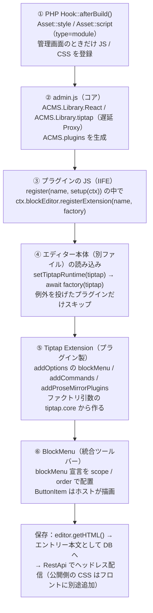
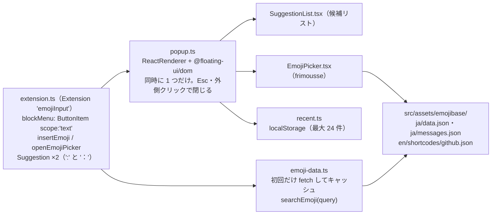

# BlockEditorEmoji 設計書 — 絵文字のサジェストとピッカー

a-blog cms のブロックエディターに機能を追加する**独立したプラグイン**の設計書。この 1 冊だけで実装を始められるようにしてある。

関連：[画像フロート（BlockEditorImageFloat） の設計書](https://github.com/uidev1116/acms-block-editor-image-float/blob/master/docs/design.md)（別プラグイン。依存関係はなく、並行して実装できる）

作成 2026-10-18 ／ 対象 @ablogcms/* 3.2.37（Tiptap 3.3x / React 19） ／ ビルド Vite 8 ライブラリモード（IIFE） ／ plugins/BlockEditorEmoji/

> **UI パターン：S1（縦リスト）・T1（ツールバーのボタン＋ショートカット）・P1（フルピッカー）で実装した**
>
> UI モック（バックエンドの `docs/block-editor-plugins/emoji/ui-mock.html`。手元で見る用でコミットしない。要約は付録）の 3 観点のうち、推奨案を採用した。T2 に変える場合は `registerBlockDefinition` の追加、T3 なら frimousse とピッカーが不要になる。保存形式（4.2）はどの案でも同じ。実装で設計から変えた点は 7 章にまとめてある。

## 1. 概要とゴール

#### BlockEditorEmoji（絵文字）

本文テキストに絵文字を入れられるようにする。①`:`／`：` に続けて入力すると候補が出る（`:わら`、`:smile`）②ツールバーのボタンから検索付きピッカーを開く。

> **原則**
>
> - a-blog cms コア（`ablogcms/js`、`php` など）は**編集しない**（CLAUDE.md）。拡張はすべて公開されている拡張基盤 `ACMS.plugins` 経由で行う。
> - Tiptap / ProseMirror / React は**ホスト（コア）と同じインスタンスを使う**。プラグインに同梱すると ProseMirror が二重化して `instanceof` 判定やスキーマ互換が壊れるため（`@ablogcms/block-editor/tiptap` の型コメントに明記されている）。
> - 保存される HTML は、**プラグインを無効化しても壊れず、ヘッドレス（RestApi）で配信されるフロント側でもそのまま扱える**形にする。

## 2. @ablogcms パッケージ調査

npm の `@ablogcms` スコープには 3.2.37 時点で 23 パッケージがある。`npm pack` で中身（`.d.ts` と `dist`）を取得し、ローカルのコア（`ablogcms/js/src/admin.js`、`features/block-editor/*`）と照らし合わせて確認した。

### 2.1 パッケージ一覧と採否

【実行時に使う】 バンドルに入る（どれも数 KB の薄いファサード） 【型だけ】 `import type` 専用の devDependency。実体はホストのものを使う 【使わない】

| パッケージ | 中身 | 採否 | 用途・理由 |
|---|---|---|---|
| `@ablogcms/plugins` | `ACMS.plugins` へのファサード。`register(name, {setup(ctx)})` | 【実行時】 | 入口。`ctx.blockEditor.registerExtension` / `ctx.i18n` / `ctx.config` / `ctx.keyboardShortcuts` を使う。`unregister` 時は自動で後片付けされる。 |
| `@ablogcms/block-editor` | Tiptap ベースのブロックエディター本体 | 【型だけ】 | `/types`（`BlockMenuToolbarItem`、`BlockDefinition`）、`/tiptap`（`Tiptap` 型 ＝ ファクトリに渡されるランタイム）。**値は import しない**（本体が丸ごと同梱される）。 |
| `@ablogcms/i18n` | `t()` のファサード（`ACMS.i18n` に委譲） | 【実行時】 | ツールチップなどの翻訳を引く。登録は `ctx.i18n.addResources`、参照は `t('plugin-name:key')`。 |
| `@ablogcms/events` | 型付きイベントバス（`ACMS.events`） | 【使わない】 | この機能はエディター内で完結し、フックすべきイベントが無い（ブロックエディター系のイベントは未定義）。購読が必要になったら `ctx.events.on` を使う（直接 import は不要）。 |
| `@ablogcms/types` | 横断型。`MaterialSymbol` 等 | 【型だけ】 | アイコン名の型チェック。`add_reaction` が存在することを確認済み。 |
| `@ablogcms/components` | 管理画面 UI 部品（popover, dropdown-menu など） | 【使わない】 | `react-dom`・`@floating-ui/react`・`@dnd-kit` などに依存し、`ReactDOM` はグローバルに公開されていないため、同梱すると重いうえに二重化する。ツールバーのボタンはホストの描画（`BlockMenuButtonItem`）に任せる。 |
| `@ablogcms/react-utils` / `react-hooks` | React ヘルパー | 【使わない】 | 必要なのは `ReactRenderer`（Tiptap 由来、ランタイムで渡される）だけ。 |
| `@ablogcms/dialog` / `notify` / `media` ほか | — | 【使わない】 | 不要。 |

### 2.2 拡張の仕組み（読み込みから描画まで）



登録は `setup()` 内で同期的に完了し、Tiptap の値を必要とする処理はファクトリ（④の時点）まで遅らせる。これがこの拡張基盤の要点。

### 2.3 使う拡張ポイント（実際の型定義から抜粋）

| API | 型 / 挙動 | 使い方 |
|---|---|---|
| `ctx.blockEditor.registerExtension(name, factory)` | `(tiptap: Tiptap) => AnyExtension \| AnyExtension[] \| Promise<…>` | 1 つの `Extension` を返す。新しいノードは作らない（4.2）。 |
| `Tiptap`（ファクトリ引数） | `{ core, react, suggestion, pm: { state, model, view, transform, commands, keymap, inputrules, … } }` | `core.Extension.create`、`suggestion.Suggestion`、`react.ReactRenderer`、`pm.state.PluginKey` を使う。 |
| 拡張の `addOptions().blockMenu` | `BlockMenuButtonItem`: `{ scope, order, icon, tooltip, ariaLabel?, isActive?, isDisabled?, onSelect }`<br>`BlockMenuRenderItem`: `{ scope, order, render({editor, variant}) }` | ツールバーへのボタン追加。`scope: 'image'` は画像ブロック選択時、`'text'` はテキストブロック時に表示。コアの画像セクションは `order: -100`（`CORE_BLOCK_MENU_SECTION_ORDER`）なので、それより大きい値ならコアの後ろに並ぶ。 |
| `ctx.i18n.addResources(lng, resources)` | 名前空間はプラグイン名で固定 | `t('block-editor-emoji:openPicker')` のように参照。 |
| `ctx.config` | `ACMS.Config[camelCase(プラグイン名)]` | PHP から渡す設定値（アセット URL・既定幅など）。6. 未確認事項参照。 |
| `ctx.keyboardShortcuts.registerShortcut` | ショートカット一覧モーダルへの表示だけ | 任意。実際のキー割り当ては拡張の `addKeyboardShortcuts` で行う。 |
| `ctx.blockEditor.registerBlockDefinition` | スラッシュメニューや「ブロック追加」の項目 | 推奨案では**使わない**（編集設定でメニューに追加しないと表示されず、絵文字はブロックの挿入でもないため）。UI パターン T2（スラッシュコマンド）を選んだ場合だけ使う。 |

### 2.4 参考にした公式ドキュメント

| ドキュメント | この設計での使い方 |
|---|---|
| [プラグイン（拡張アプリ）開発の基本](https://developer.a-blogcms.jp/document/develop_apps/entry-2906.html) / [名前空間](https://developer.a-blogcms.jp/document/develop_apps/entry-2907.html) | `ServiceProvider.php` の書き方。名前空間は `Acms\Plugins\{Name}`（3.5）。 |
| [フックの拡張](https://developer.a-blogcms.jp/document/develop_apps/entry-2910.html) | `Hook::afterBuild()` で管理画面のときだけアセットを登録する（3.5）。 |
| [acms-plugin-skeleton](https://github.com/appleple/acms-plugin-skeleton) | リポジトリのひな型（3.3・3.6）。 |
| [アセット API](https://developer.a-blogcms.jp/document/develop_apps/asset-api.html) | JS / CSS の読み込み（3.5）。`type="module"` の指定、ハンドル名、自動バージョン付与。 |
| [テンプレートの挿入](https://developer.a-blogcms.jp/document/develop_apps/entry-2912.html) | 使わない（HTML を差し込む仕組みのため）。 |
| [プラグインのテスト](https://developer.a-blogcms.jp/document/develop_apps/plugin-testing.html) / [CI と複数バージョン検証](https://developer.a-blogcms.jp/document/develop_apps/plugin-testing-ci.html) | スケルトンに PHPUnit（`ablogcms/testing-framework` `3.2.*`）・PHPStan・phpcs と CI が設定済みなので、そのまま使う。PHP のロジックは `Services/AssetRegistrar` に切り出して単体テストする（3.5）。JS は vitest。 |
| 管理画面の JavaScript 拡張（`document/javascript/admin-js/`） | 2026-10-18 時点では目次だけで本文が未公開。`ACMS.plugins` の仕様は npm パッケージの型定義とコアのソースから確認した（2.1〜2.3）。 |

## 3. ビルド・配置・読み込み

### 3.1 ビルドツール：Vite 8 ライブラリモード、出力形式は IIFE

| 候補 | 判断 | 理由 |
|---|---|---|
| **Vite（lib mode, `formats: ['iife']`）** | 【採用】 | テーマ（`ablogcms/themes/develop`）ですでに Vite を使っている。`external` と `output.globals` の組み合わせで「`react` → `ACMS.Library.React`」のような externals を素直に書ける。React（JSX）・TypeScript・CSS がそのまま使える（CSS は Sass を使わず素の CSS で書く）。 |
| Vite（`formats: ['es']`）＋ `rollup-plugin-external-globals` | 【不採用（代替案）】 | ES 出力では external が `import React from 'react'` のまま残るため、`rollup-plugin-external-globals` で `ACMS.Library.*` の参照に書き換える（Vite 8.3.4 で動作確認済み）。`await import()` の部分が別ファイルになり、エディターを開くまでダウンロードもされないのが利点。ただしプラグインが 1 つ増え（2024-11 以降更新なし）、このプラグインの規模では IIFE で十分なので採用しない。JS が大きくなったら切り替えを検討する。 |
| webpack | 【不採用】 | コアは webpack だが、externals の書き方が違うだけで得るものが無い。テーマと揃える方を優先。 |
| tsup / esbuild 単体 | 【不採用】 | IIFE の globals 対応や CSS の書き出しで設定が増える。 |

#### Tiptap を使うコードを書く場所（読み込み順の制約）

プラグインの JS とエディター本体は、次の順番で読み込まれる。

| 時点 | 起きること | Tiptap（`ACMS.Library.tiptap`） |
|---|---|---|
| ① 管理画面を開く | コアの `admin.js` とプラグインの JS が読み込まれ、プラグインの `register()` → `setup()` が走る | **まだ無い**（中身が空の入れ物だけある。触ると例外） |
| ② エディターを表示する | コアがブロックエディター本体（別ファイル）を読み込む | ここで中身が入る |
| ③ その直後 | コアが、プラグインから預かったファクトリ `(tiptap) => …` を呼び、**Promise なら解決を待つ**（`block-definitions.ts`） | 使える |

したがって Tiptap の値（`Extension.create` など）は**ファクトリの中（③）で使う**。公式・サードパーティの Tiptap 拡張パッケージ（`@tiptap/extension-*`）は、ファイルの一番外側で `Node.create()` を実行するので、**ファクトリの中で `await import()` して読み込めば使える**（コアの型定義にもこの使い方が明記されている）。ファイルの先頭で普通に import すると①の時点で実行されて例外になる。

```ts
// NG：ファイルの先頭で import → ①で Node.create() が走って例外
import { Details } from '@tiptap/extension-details';
ctx.blockEditor.registerExtension('details', () => Details);

// OK：自前の拡張はファクトリの中で、引数の tiptap.core から作る
ctx.blockEditor.registerExtension('myExtension', (tiptap) =>
  tiptap.core.Extension.create({ … }));

// OK：外部の Tiptap 拡張パッケージは、ファクトリの中で await import()
ctx.blockEditor.registerExtension('details', async () => {
  const { Details } = await import('@tiptap/extension-details');
  return Details;
});
```

> **IIFE でも await import() は後回しで実行される（Vite 8.3.4 で実測）**
>
> IIFE はファイルを分けられないので、`await import()` で読むコードも同じファイルに入る。ただし Vite 8 のバンドラー（Rolldown）は、その部分を `__esmMin(…)` という遅延初期化で包み、**呼ばれるまで実行しない**（旧来の Rollup はファイル読み込み時に実行していた）。コアと同じ順序（①→②→③）を Node で再現し、`@tiptap/extension-details` が③で正しく作られ、ホストの Tiptap のクラスのインスタンスになることを確認した。先頭で import した場合は①で例外になることも確認した。

外部パッケージを使う場合の注意：

- そのパッケージが import する `@tiptap/core`・`@tiptap/pm/*`・`@tiptap/suggestion`・`@tiptap/react` は、3.2 の externals でホストの実体に置き換わる。それ以外の依存（例：`@tiptap/extensions`）はホストが公開していないのでプラグインに同梱される。
- バージョンはホストの Tiptap（`@ablogcms/block-editor` が依存している版）とメジャー・マイナーを合わせる。
- この挙動はバンドラーの実装に依存するので、**ビルド成果物の読み込みテスト**（Tiptap が無い状態でプラグインの JS を読み込んでも例外にならず、Tiptap を用意した後にファクトリが拡張を返すこと）を vitest に入れておく（5 章）。

**絵文字辞書を JS に含めない理由**：辞書（emojibase の `ja/data.json`）は約 720KB（gzip で約 95KB）ある。IIFE はファイルを分けられないので、JS に含めると実行は後回しにできても**ダウンロードは毎回**発生し、プラグインの JS（約 60KB）が約 800KB に膨らむ。絵文字を一度も使わない管理画面のページでも読み込まれることになる。そこで辞書は `src/assets/emojibase/` に別ファイルとして置き、`:` を初めて入力したときやピッカーを初めて開いたときに `fetch` で取りに行く（4.5 (5)）。

### 3.2 externals（ホストの実体を参照するモジュール）

| import 元 | グローバル（`output.globals`） | 公開元 | 備考 |
|---|---|---|---|
| `react` | `ACMS.Library.React` | `admin.js` 68 行目 | React 19。hooks も含めてホストの実体を使う。 |
| `react/jsx-runtime` | `ACMS.Library.ReactJsxRuntime` | `admin.js` 73 行目 | 自動 JSX ランタイム（`jsx: 'react-jsx'`）のまま書けるよう公開されている。 |
| `@tiptap/core` | `ACMS.Library.tiptap.core` | `admin.js` 77 行目（遅延 Proxy） | **安全網として**指定する。誤って値を import してもバンドルに入らない。Proxy なので IIFE の早期束縛でも後から実体に届くが、**ファクトリ実行前に値へ触れると例外**になる。基本はファクトリ引数を使う。 |
| `@tiptap/react` | `ACMS.Library.tiptap.react` | 同上 | 〃 |
| `@tiptap/suggestion` | `ACMS.Library.tiptap.suggestion` | 同上 | 〃 |
| `@tiptap/pm/state` など | `ACMS.Library.tiptap.pm.state` など | 同上 | 〃 |
| `react-dom` | —（公開されていない） | — | **import しない**。ポップアップは Tiptap の `ReactRenderer`（ホストの React ツリーにポータルで描画する）を使う。 |

### 3.3 リポジトリ構成（acms-plugin-skeleton がベース）

開発は [appleple/acms-plugin-skeleton](https://github.com/appleple/acms-plugin-skeleton)（Packagist：`ablogcms/plugin-skeleton`）から始める。スケルトンは **`src/` がプラグイン本体**（＝ `extension/plugins/BlockEditorEmoji/`）、テストと設定ファイルはリポジトリ直下、という構成で、PHPUnit・PHPStan・PHP_CodeSniffer・GitHub Actions（テスト・リリース）・zip 作成のスクリプトが揃っている。ここに JS のビルド一式を足す。

```text
acms-block-editor-emoji/                 ← GitHub: uidev1116/acms-block-editor-emoji
│                                    （バックエンドには plugins/BlockEditorEmoji/ として submodule で追加）
├── composer.json / composer.lock    # スケルトン由来：lint / analyse / test / check / package / release:*
├── phpcs.xml.dist / phpstan.neon.dist / phpunit.xml.dist
├── docker-compose.yml / .env.example # PHPUnit 用（appleple/acms:3.2-php8.4 + MySQL）。ポートは .env で変える
├── package.json / package-lock.json  # Vite / vitest / TypeScript（3.4）
├── tsconfig.json / vite.config.ts / vitest.config.ts
├── .node-version                    # Node のバージョン（CI と揃える）
├── frontend/                         # JS/TS・CSS のソース（zip には入らない）
│   ├── index.ts                     # register() の入口（ACMS.plugins が無ければ何もしない）
│   ├── extension.ts                 # createEmojiExtension(tiptap, deps)
│   ├── suggestion.ts / popup.ts     # 4.4 参照
│   ├── SuggestionList.tsx / EmojiPicker.tsx
│   ├── emoji-data.ts / recent.ts
│   ├── i18n.ts                      # ja / en リソース
│   └── style.css                    # ピッカー・リストの素の CSS（index.ts から import）
├── scripts/copy-emojibase.mjs       # ビルド後に emojibase-data の必要ファイルを src/assets/emojibase/ へコピー
├── tests/
│   ├── phpunit/Unit/Services/AssetRegistrarTest.php
│   └── js/
│       ├── emoji-data.test.ts       # searchEmoji（ひらがな/カタカナ・ショートコード・並び順）
│       ├── recent.test.ts
│       └── bundle-load.test.ts      # ビルド成果物の読み込みテスト（3.1）
├── .github/workflows/test.yml        # スケルトンの quality / phpunit に frontend ジョブを追加（3.6）
├── .github/workflows/release.yml     # スケルトンのまま（v* タグで zip を GitHub Release に公開）
├── README.md / LICENSE (MIT)
└── src/                              # プラグイン本体
    ├── ServiceProvider.php           # $version がバージョンの正（タグと一致させる）
    ├── Hook.php                      # afterBuild() → AssetRegistrar（3.5）
    ├── Services/AssetRegistrar.php   # 読み込み判定とパス組み立て（PHPUnit で単体テスト）
    └── assets/                       # vite build の出力（Git には含めない。リリース時にビルドして zip にだけ含める）
        ├── index.js
        ├── index.css
        └── emojibase/               # ja/data.json, ja/messages.json, en/shortcodes/github.json
```

**スケルトンから削除するもの**：`src/GET/`・`src/POST/`・`src/Modules/`・`src/Corrector.php`・`src/Validator.php`・`src/Services/SampleService.php`・`src/template/`・サンプルのテスト、と `ServiceProvider::init()` 内のそれらの登録。

**スケルトンの始め方**（名前の置換スクリプトは対話入力を求めるので、引数で渡す）：

```bash
composer create-project ablogcms/plugin-skeleton acms-block-editor-emoji --no-scripts --no-interaction
cd acms-block-editor-emoji
php scripts/namespace.php BlockEditorEmoji      # Skeleton → BlockEditorEmoji に置換（スクリプトは自分自身を削除する）
rm -f CONTRIBUTING.md                  # スケルトン用の文書。LICENSE は自分の名前の MIT に差し替える
git init -b master && git add -A && git commit -m "Initial commit from ablogcms/plugin-skeleton"
```

名前の対応：

| GitHub リポジトリ | PHP（ディレクトリ・名前空間・`$name`） | JS（`register` 名 ＝ i18n 名前空間） | `ctx.config` のキー |
|---|---|---|---|
| `uidev1116/acms-block-editor-emoji` | `BlockEditorEmoji`（`Acms\Plugins\BlockEditorEmoji`） | `block-editor-emoji` | `ACMS.Config.blockEditorEmoji` |

スケルトンの `docker-compose.yml` は `8080` 番ポートを固定で使うが、手元では 8080 を traefik が使っている。`ports` を `'${ACMS_PORT:-8080}:80'` に変え、`.env.example` に `ACMS_PORT=18082` を足す（もう一方のプラグインは別の番号を使うので、同時に起動しても衝突しない）。`ACMS_IMAGE_TAG` は `3.2-php8.4` にする。

### 3.4 package.json / vite.config.ts / tsconfig.json の雛形

**`plugins/BlockEditorEmoji/package.json（抜粋）`**

```jsonc
{
  "name": "acms-block-editor-emoji",
  "private": true,
  "type": "module",
  "scripts": {
    "setup": "npm run build",              // バックエンドの tools/setup.js が submodule ごとに呼ぶ（必須）
    "dev": "vite build --watch --mode development",
    "typecheck": "tsc --noEmit",
    "coverage": "vitest run --coverage",
    "build": "vite build && node scripts/copy-emojibase.mjs",
    "test": "vitest run"
  },
  "dependencies": {
    "@ablogcms/plugins": "3.2.37",
    "@ablogcms/i18n": "3.2.37",
    "frimousse": "^0.4.0",
    "@floating-ui/dom": "^1"
  },
  "devDependencies": {
    "@ablogcms/block-editor": "3.2.37",   // 型だけ（import type）
    "@ablogcms/types": "3.2.37",          // 型だけ
    "@tiptap/core": "（block-editor が依存しているのと同じ版）", // Commands の module augmentation 用。型だけ
    "@types/react": "^19",
    "emojibase-data": "（frimousse が想定するメジャー版に固定）", // JS には含めずコピーして配信
    "react": "^19",                       // 型解決用。external なので同梱されない
    "@vitejs/plugin-react": "最新",
    "typescript": "^5",
    "vite": "^8",
    "vitest": "最新"
  }
}
```

CSS は `frontend/style.css` を `index.ts` から `import './style.css'` すると、Vite が `src/assets/index.css` に書き出す。Sass などのプリプロセッサーは使わない。

`@ablogcms/*` は**インストール済みのコアと同じバージョンに固定**する（拡張 API の型がコアと一致している必要がある）。コアを更新したら合わせて上げる。

**`plugins/BlockEditorEmoji/vite.config.ts`**

```ts
import { defineConfig } from 'vite';
import react from '@vitejs/plugin-react';

const TIPTAP_PM = ['state', 'model', 'view', 'transform', 'commands', 'keymap', 'inputrules',
  'changeset', 'dropcursor', 'gapcursor', 'history', 'schema-list', 'tables'] as const;
const camel = (s: string) => s.replace(/-(\w)/g, (_, c) => c.toUpperCase());

// externals：import 元 → ホストが公開しているグローバル
const globals: Record<string, string> = {
  react: 'ACMS.Library.React',
  'react/jsx-runtime': 'ACMS.Library.ReactJsxRuntime',
  '@tiptap/core': 'ACMS.Library.tiptap.core',
  '@tiptap/react': 'ACMS.Library.tiptap.react',
  '@tiptap/suggestion': 'ACMS.Library.tiptap.suggestion',
  ...Object.fromEntries(TIPTAP_PM.map((p) => [`@tiptap/pm/${p}`, `ACMS.Library.tiptap.pm.${camel(p)}`])),
};

export default defineConfig(({ mode }) => ({
  plugins: [react()],
  define: { 'process.env.NODE_ENV': JSON.stringify('production') }, // 7 章 (2)
  publicDir: false,              // 絵文字データはビルド後に別途コピーする（4.5 (6)）
  build: {
    outDir: 'src/assets',
    emptyOutDir: true,
    sourcemap: mode === 'development',
    minify: mode !== 'development',
    lib: {
      entry: 'frontend/index.ts',
      formats: ['iife'],
      name: 'AcmsBlockEditorEmoji',   // IIFE の戻り値を入れるグローバル名（使わないが必須）
      fileName: () => 'index.js',
      cssFileName: 'index',
    },
    // Vite 8 は Rolldown。rollupOptions は互換エイリアスとして残っているが、新しい名前は rolldownOptions
    rolldownOptions: {
      external: (id) => id in globals,
      output: { globals, banner: BOOT_BANNER, footer: BOOT_FOOTER }, // 7 章 (1)：実行を ACMS.adminReady まで遅らせる
    },
  },
}));
```

ビルド後、`src/assets/index.js` に `react` や `@tiptap` の実装が含まれていないことを確認する（`grep -c "prosemirror" src/assets/index.js` が 0、バンドルサイズの目安は 60KB 未満、絵文字データも含まれていないこと）。

**`plugins/BlockEditorEmoji/tsconfig.json（要点）`**

```jsonc
{
  "compilerOptions": {
    "target": "ES2022", "module": "ESNext", "moduleResolution": "Bundler",
    "jsx": "react-jsx", "strict": true, "noEmit": true, "skipLibCheck": true,
    "lib": ["ES2022", "DOM", "DOM.Iterable"],
    "types": ["vite/client"]
  },
  "include": ["frontend"]
}
```

`window.ACMS` の型は `@ablogcms/types/acms` の `Acms` インターフェースで、`@ablogcms/plugins/acms` と `@ablogcms/block-editor/acms` がそれを拡張している。必要なら `frontend/env.d.ts` で `import type {} from '@ablogcms/plugins/acms'` のように読み込んで補完を効かせる。

### 3.5 PHP 側：アセット API で JS / CSS を読み込む

Ver. 3.2.29 で追加された[アセット API](https://developer.a-blogcms.jp/document/develop_apps/asset-api.html)（`Acms\Services\Facades\Asset`）を使う。手元のコアにも `php/Services/Facades/Asset.php` があることを確認済み。テンプレート挿入（InjectTemplate）は HTML を差し込むための仕組みなので、JS / CSS の読み込みには使わない。

| 呼ぶ場所 | 判断 | 理由 |
|---|---|---|
| `ServiceProvider::init()` | 【不採用】 | ページによらず常に読み込まれる。公開側のページには `ACMS.plugins` が無く、`register()` が例外を投げる。 |
| `Hook::afterBuild(&$res)` | 【採用】 | ドキュメントで「ページの種類などで出し分ける場合」に使う場所とされている。管理画面（エントリー編集を含む）のときだけ登録する。 |

**`plugins/BlockEditorEmoji/src/ServiceProvider.php（要点）`**

```php
namespace Acms\Plugins\BlockEditorEmoji;

use ACMS_App;
use Acms\Services\Common\HookFactory;

class ServiceProvider extends ACMS_App
{
    public $version = '0.1.0';
    public $name = 'BlockEditorEmoji';
    public $author = 'uidev1116';
    public $module = false;
    public $menu = false;
    public $desc = 'ブロックエディターに絵文字のサジェストとピッカーを追加します。';

    public function init()
    {
        HookFactory::singleton()->attach('BlockEditorEmojiHook', new Hook());
    }
    public function checkRequirements() { return true; }
    public function install() {}
    public function uninstall() {}
    public function update() { return true; }
    public function activate() { return true; }
    public function deactivate() { return true; }
}
```

**`plugins/BlockEditorEmoji/src/Hook.php`**

```php
namespace Acms\Plugins\BlockEditorEmoji;

use Acms\Services\Facades\Asset;

class Hook
{
    private const HANDLE = 'block-editor-emoji';

    public function afterBuild(&$res)
    {
        // 管理画面（エントリー編集画面を含む）だけで読み込む。判定方法は 6 章 U-1 で確認する
        if (!defined('ADMIN') || !ADMIN) {
            return;
        }
        // '/' . DIR_OFFSET から始めると、ローカルのファイルとして扱われ、更新日時のクエリが自動で付く
        $base = '/' . DIR_OFFSET . 'extension/plugins/BlockEditorEmoji/assets/';

        Asset::style(self::HANDLE . '-style', $base . 'index.css'); // 既定の出力位置は head
        Asset::script(self::HANDLE, $base . 'index.js', [
            'position' => 'body_end',
            'attrs' => ['type' => 'module'],
        ]);
    }
}
```

- **`type="module"`**：ドキュメントに「管理画面の JavaScript 拡張を読み込む場合は `type="module"` を指定する。プラグインの登録が管理画面の処理より先に実行されることが保証される」とある。そのため `deps` は指定しない（`head` と `body_end` をまたいだ依存は指定できない仕様でもある）。
- **ハンドル名**は他と重ならないようプラグイン名を付ける。CSS と JS で同じハンドルにすると後から登録した方が無視されるので、CSS には `-style` を付ける。
- **キャッシュ対策**：ローカルのファイルには自動でバージョンのクエリが付くので、`?v=` を手で書かない（`php/Services/Asset/AssetPathResolver.php` が `'/' . DIR_OFFSET` で始まるパスをローカルファイルと判定する）。
- **テスト**：スケルトンの方針（ハンドラーは薄く、ロジックはサービスへ）に合わせ、「読み込むかどうかの判定」と「パスの組み立て」を `src/Services/AssetRegistrar.php` に切り出し、`Hook::afterBuild()` はそれを呼ぶだけにする。`AssetRegistrar` は `tests/phpunit/Unit/` で単体テストする（DB 不要）。
- 念のため JS 側でも、`index.ts` の先頭で `window.ACMS?.plugins` が無ければ何もしないようにしておく。

### 3.6 GitHub・CI・バックエンドへの取り込み・デプロイ

| 項目 | 方針 |
|---|---|
| リポジトリ | `uidev1116/acms-block-editor-emoji`（public。ApiPreview と同じ）。既定ブランチは `master`。初回コミット（スケルトンを置換しただけの状態）だけを `master` に置き、実装は `feat/initial-implementation` ブランチで行って PR を出す。マージは人が行う。 |
| バックエンドへの取り込み | `git submodule add git@github.com:uidev1116/acms-block-editor-emoji.git plugins/BlockEditorEmoji`（`.gitmodules` は既存の ApiPreview と同じ SSH URL。デプロイの CI は HTTPS に読み替える）。`npm run setup`（`tools/setup.js`）が `ablogcms/extension/plugins/BlockEditorEmoji → ../../../plugins/BlockEditorEmoji/src` のシンボリックリンクを作る。Docker の web コンテナは `./plugins` を `/var/www/plugins` にマウントしているので、このリンクがそのまま効く。 |
| `npm run setup` | `tools/setup.js` は各 submodule で `npm ci` → `npm run setup` を実行するので、`package.json` に `setup` スクリプトが**必須**（`"setup": "npm run build"`）。 |
| ビルド成果物 | `src/assets/` は **Git に含めない**（`.gitignore`）。リリース時（`v*` タグ）に `release.yml` が `npm ci && npm run build` でビルドし、配布用の zip にだけ含める。`test.yml` の `frontend` ジョブでも、ビルドが通り成果物ができることだけを確認する。ローカルでは `npm run setup`（= `npm run build`）で作る。**バックエンドの現行デプロイ（`plugins/*/src` の rsync）はビルドしないため、そのままでは `assets/` が本番に届かない**。本番へは、リリースの zip を展開して反映するか、バックエンドのデプロイにビルド手順を足す必要がある（7 章の要判断事項）。 |
| CI（`test.yml`） | スケルトンの `quality`（phpcs・PHPStan）と `phpunit`（PHP 8.1〜8.5 × a-blog cms 3.2）はそのまま使い、`frontend` ジョブを追加する：`setup-node`（`.node-version`）→ `npm ci` → `npm run typecheck` → `npm run coverage` → `npm run build` → 成果物ができていること。集約ジョブ `test` の `needs` に `frontend` を足す。 |
| リリース | スケルトンのまま。`composer release:patch` などで `ServiceProvider::$version` を上げてタグを打ち、push すると `release.yml` が zip を GitHub Release に公開する。`package.json` の `version` と `frontend/index.ts` の `version` も同じ値にそろえる。 |
| 本番デプロイ | プラグインの PR をマージした後、バックエンドで submodule の参照先を更新してコミットし、既存のデプロイ（`.github/workflows/deploy.yml`、rsync）で反映する。デプロイのワークフローは変更しない。**デプロイは明示的に許可されたときだけ**行う。 |

- lint-staged / Prettier の対象（`tools/**`、テーマ）には `plugins/` は含まれないので、バックエンド側の設定は変えない。

## 4. 機能設計：絵文字のサジェストとピッカー

### 4.1 要件

- **E-1 サジェスト**：テキスト中で `:`（半角）または `：`（全角。日本語 IME のままでも使えるように）に続けて 1 文字以上入力すると、候補リスト（最大 8 件）が出る。日本語（`:わらい`、`:ねこ`）、英語ショートコード（`:smile`、`:+1`）の両方で検索できる。
- **E-2 キーボード操作**：↑↓ で選択、Enter / Tab で確定、Esc で閉じる。IME の変換中（`isComposing`）のキー操作は無視する。
- **E-3 ピッカー**：テキストブロック選択時のツールバーに「絵文字」ボタン（`add_reaction`）を出し、押すとカーソル位置に検索付きの絵文字ピッカーが開く。カテゴリ表示・肌の色選択・最近使った絵文字（`localStorage`）を持つ。
- **E-4 ショートカット**：`Mod-Alt-e`（要確認：既存のショートカットとの衝突）でピッカーを開く。ショートカット一覧にも登録する。
- **E-5 除外**：コードブロック内と、インラインコードの中ではサジェストを出さない。`10:30` のように直前が英数字の場合も出さない。
- **E-6 出力**：絵文字は**Unicode の文字そのもの**として本文に入る（下記）。

### 4.2 データモデル：Unicode の文字をそのまま挿入（新しいノードは作らない）

| 案 | 判断 | 理由 |
|---|---|---|
| **プレーンテキストとして挿入**（`insertContent('😄')`） | 【採用】 | スキーマを変えないので、プラグインを外しても本文はそのまま。RestApi で配信されたフロント側でも追加の処理が要らない。コピー＆ペースト・検索・Markdown 変換でも自然に扱える。 |
| `@tiptap/extension-emoji`（インラインの `emoji` ノード） | 【不採用】 | 保存 HTML が `<span data-type="emoji" data-name="smile">` になり、プラグインを外すと未知の要素として扱われる。（ファクトリ内の `await import()` で読み込むこと自体は可能。3.1 参照）`emojibase-data` 全量を JS に同梱する形になり重い。 |
| 画像（Twemoji 等の SVG）として挿入 | 【不採用】 | ブログ用途では過剰。OS のネイティブ絵文字で十分。 |

### 4.3 使うライブラリ

| ライブラリ | 入手元 | 用途 | 判断理由 |
|---|---|---|---|
| `Suggestion` | **ランタイム**（`tiptap.suggestion`） | `:` トリガーの検出・候補の状態管理 | ホストがスラッシュコマンドに使っているのと同じ実体。同梱しない。 |
| `ReactRenderer` | **ランタイム**（`tiptap.react`） | 候補リストとピッカーの描画 | エディターの React ツリーにポータルで描画するので、公開されていない `react-dom` が不要。 |
| `frimousse` 0.4 | npm（同梱） | ピッカー UI | 依存は `react` と `react/jsx-runtime` だけ（ソースで確認済み）で、どちらも external にできる。スタイルなし・合成型の部品で、管理画面の見た目に合わせやすい。仮想スクロール・キーボード操作・`locale="ja"`・肌の色に対応。データの取得先を `emojibaseUrl` で変えられる。 |
| `emojibase-data` | npm（**JS には含めず静的ファイルとしてコピー**） | ピッカーとサジェストの辞書 | frimousse が使うデータそのもの。`ja/data.json`（日本語の名前・タグ）、`ja/messages.json`（カテゴリ名）、`en/shortcodes/github.json`（`:smile` 形式）を `src/assets/emojibase/` にコピーする。frimousse の既定は jsDelivr の CDN から取得するが、管理画面から外部 CDN に依存しないよう自前で配信する。 |
| `@floating-ui/dom` | npm（同梱、約 6KB） | ポップアップの位置合わせ | ホストの block-editor も使っているが公開されていないので同梱する。状態を持たない純粋関数なので二重化しても問題ない。 |
| `emoji-mart` | — | — | 【不採用】：Web Components ベースで重く、`@emoji-mart/react` の peer が React 18 までで止まっている（2023 年以降更新なし）。 |

### 4.4 構成



サジェストとピッカーは同じポップアップ制御と辞書を共有する。ピッカーは frimousse が辞書を直接取得する（同じ URL なのでブラウザのキャッシュが効く）。

**`plugins/BlockEditorEmoji/frontend/`**

```text
index.ts              register()。config から assetsUrl を決める
extension.ts          createEmojiExtension(tiptap, deps)
suggestion.ts         Suggestion の設定（items / command / allow / render）
popup.ts              createPopup(tiptap, Component, props, anchor) → { update, destroy, onKeyDown }
SuggestionList.tsx    候補リスト（forwardRef で onKeyDown を公開）
EmojiPicker.tsx       frimousse の合成
emoji-data.ts         loadEmojiData(baseUrl) / searchEmoji(data, query)
recent.ts             getRecent() / pushRecent(emoji)
i18n.ts
style.css            素の CSS（Sass は使わない）
```

### 4.5 実装

#### (1) 入口とアセット URL

```ts
// frontend/index.ts
import { register } from '@ablogcms/plugins';

register('block-editor-emoji', {
  version: '0.1.0',
  setup(ctx) {
    ctx.i18n.addResources('ja', resources.ja);
    ctx.i18n.addResources('en', resources.en);
    // 優先：PHP から渡す ACMS.Config.blockEditorEmoji.assetsUrl。無ければ ROOT_DIR から組み立てる
    const assetsUrl = String(ctx.config.assetsUrl ?? `${ACMS.Config.root}extension/plugins/BlockEditorEmoji/assets`);
    const deps = { emojibaseUrl: `${assetsUrl}/emojibase` };
    ctx.keyboardShortcuts.registerShortcut('open-picker', { /* 型に合わせる。表示用のみ */ });
    ctx.blockEditor.registerExtension('emojiInput', (tiptap) => createEmojiExtension(tiptap, deps));
  },
});
```

#### (2) Extension

```ts
// frontend/extension.ts（骨子）
export function createEmojiExtension(tiptap: Tiptap, deps: Deps) {
  const { core, suggestion: { Suggestion }, pm: { state: { PluginKey } } } = tiptap;
  return core.Extension.create<EmojiOptions>({
    name: 'emojiInput',
    addOptions() {
      return {
        blockMenu: [{
          scope: 'text',
          order: 50,
          icon: 'add_reaction',
          tooltip: t('block-editor-emoji:openPicker'),
          onSelect: (editor) => editor.commands.openEmojiPicker(),
        }],
      };
    },
    addCommands() {
      return {
        insertEmoji: (emoji: string) => ({ chain }) => chain().focus().insertContent(emoji).run(),
        openEmojiPicker: () => ({ editor }) => { openPicker(tiptap, editor, deps); return true; },
      };
    },
    addKeyboardShortcuts() {
      return { 'Mod-Alt-e': () => this.editor.commands.openEmojiPicker() };
    },
    addProseMirrorPlugins() {
      return [':', '：'].map((char, i) => Suggestion({
        editor: this.editor,
        pluginKey: new PluginKey(`emojiSuggestion${i}`),
        char,
        allowedPrefixes: [' ', '　'],   // 行頭は既定で許可される（要確認）。英数字の直後は出さない
        allowSpaces: false,
        allow: ({ state, range }) => isAllowedPosition(state, range), // コードブロック・code マーク内は false
        items: async ({ query }) => query.length < 1 ? [] : searchEmoji(await loadEmojiData(deps.emojibaseUrl), query, 8),
        command: ({ editor, range, props }) => {
          editor.chain().focus().insertContentAt(range, props.emoji).run();
          pushRecent(props.emoji);
        },
        render: () => createSuggestionRender(tiptap),   // popup.ts + SuggestionList
      }));
    },
  });
}
```

- `Suggestion` の `render` は `onStart / onUpdate / onKeyDown / onExit` を返す。`onStart` で `new ReactRenderer(SuggestionList, { editor, props })` を作り、`renderer.element` を `document.body` に追加して `props.clientRect` を基準に `computePosition`（`placement: 'bottom-start'`、`flip`、`shift`）で配置する。
- `onKeyDown` で `event.isComposing` なら `false` を返す（IME の確定 Enter を奪わない）。
- 候補が 0 件のときはリストを閉じる（「該当なし」を出し続けると `:` を含む普通の文章の入力を邪魔するため）。

#### (3) ピッカーを開く処理

```ts
function openPicker(tiptap: Tiptap, editor: Editor, deps: Deps) {
  const range = { from: editor.state.selection.from, to: editor.state.selection.to }; // 開く前の選択範囲を保存
  const coords = editor.view.coordsAtPos(range.from);
  const popup = createPopup(tiptap, editor, EmojiPicker, {
    emojibaseUrl: deps.emojibaseUrl,
    onSelect: (emoji: string) => {
      editor.chain().focus().insertContentAt(range, emoji).run();
      pushRecent(emoji);
      popup.destroy();
    },
    onClose: () => { popup.destroy(); editor.commands.focus(); },
  }, () => DOMRect.fromRect({ x: coords.left, y: coords.top, width: 0, height: coords.bottom - coords.top }));
}
```

ピッカーの検索欄にフォーカスが移るとエディターの選択範囲が見えなくなるため、**開く前の範囲を保存して** `insertContentAt(range, …)` で挿入する。ポップアップは同時に 1 つだけ開く（サジェスト表示中にピッカーを開いたらサジェストを閉じる）。

#### (4) EmojiPicker（frimousse）

```ts
import { EmojiPicker as P } from 'frimousse';

export function EmojiPicker({ emojibaseUrl, onSelect, onClose }: Props) {
  return (
    <P.Root
      className="acms-admin-emoji-picker"
      locale="ja"
      emojibaseUrl={emojibaseUrl}
      columns={9}
      onEmojiSelect={({ emoji }) => onSelect(emoji)}
      onKeyDown={(e) => { if (e.key === 'Escape') onClose(); }}
    >
      <P.Search placeholder={t('block-editor-emoji:search')} autoFocus />
      <RecentRow onSelect={onSelect} />            {/* recent.ts の自前描画 */}
      <P.Viewport>
        <P.Loading>{t('block-editor-emoji:loading')}</P.Loading>
        <P.Empty>{t('block-editor-emoji:empty')}</P.Empty>
        <P.List />
      </P.Viewport>
      <P.SkinToneSelector />
    </P.Root>
  );
}
```

API 名（`onEmojiSelect`・`SkinToneSelector` など）は frimousse 0.4 の型定義で確認してから使う。スタイルは素の CSS（`style.css`）で書き、管理画面の配色（`--acms-*` の CSS 変数があればそれ）に合わせる。

#### (5) 辞書と検索

```ts
// emoji-data.ts
interface EmojiEntry { emoji: string; label: string; tags: string[]; shortcodes: string[]; order: number }

let cache: Promise<EmojiEntry[]> | null = null;
export function loadEmojiData(baseUrl: string): Promise<EmojiEntry[]> {
  cache ??= Promise.all([
    fetch(`${baseUrl}/ja/data.json`).then((r) => r.json()),
    fetch(`${baseUrl}/en/shortcodes/github.json`).then((r) => r.json()),
  ]).then(([data, github]) => normalize(data, github))       // hexcode でショートコードを結合
    .catch((e) => { cache = null; throw e; });                // 失敗したら次回に再試行
  return cache;
}

/** 純粋関数（vitest 対象）。スコア順：ショートコード前方一致 > 名前前方一致 > タグ前方一致 > 部分一致。同点は order 順 */
export function searchEmoji(data: EmojiEntry[], query: string, limit: number): EmojiEntry[] { … }
```

- クエリはひらがな・カタカナを同一視する（`ネコ` でも `ねこ` でもヒット）。全角英数は半角に寄せる。
- 肌の色のバリエーション（`skins`）はサジェストでは基本形だけ出す。ピッカーでは frimousse の肌の色選択に従う。
- ブラウザが表示できない新しい絵文字（豆腐になるもの）は、frimousse の `emojiVersion` の自動判定に任せる。サジェスト側も同じバージョンで絞り込む（任意）。

#### (6) 絵文字データのコピー

ビルド時に `node_modules/emojibase-data` から必要な 3 ファイルだけを `src/assets/emojibase/` にコピーする。`vite-plugin-static-copy` でも、`package.json` の `"prebuild"` に小さな Node スクリプトを置く形でもよい（`emptyOutDir: true` で消えないよう、コピーはビルド後に行う）。`emojibase-data` は frimousse が想定しているメジャーバージョンに合わせて固定する。

### 4.6 受け入れ条件

- [ ] 段落で `:smile` と入力すると 😄 が候補に出て、Enter で `:smile` が 😄 に置き換わる。
- [ ] 日本語 IME オンのまま `：ねこ` と入力し、変換を確定した後に候補が出る。IME の確定 Enter で絵文字が入ってしまわない。
- [ ] `10:30`、`https://`、コードブロック内、インラインコード内では候補が出ない。
- [ ] 候補が 0 件のときはリストが出ない。Esc で閉じた後は普通に入力を続けられる。
- [ ] ツールバーの絵文字ボタン／`Mod-Alt-e` でピッカーが開き、検索・カテゴリ・肌の色・最近使った絵文字が使える。選ぶとピッカーを開く前のカーソル位置に入る。
- [ ] 見出し・リスト・表のセル・画像のキャプションの中でも使える（使えない場所ではボタンが出ないか、押しても何も起きない）。
- [ ] 保存した HTML に絵文字が文字として入っていて、余計な要素が無い。
- [ ] オフラインや 404 で辞書の取得に失敗しても、エディターは動き続ける（ピッカーにエラーを表示し、次に開いたとき再取得する）。
- [ ] vitest：`searchEmoji`（ひらがな／カタカナ、ショートコード、並び順）と `recent.ts`。
- [ ] バンドルに react / tiptap / prosemirror の実装が含まれず、絵文字データも含まれていない（JS は 60KB 未満が目安）。

## 5. 実装タスク

リポジトリの作成とバックエンドへの submodule 追加は、事前準備として済ませておく（手順書（バックエンドの `docs/block-editor-plugins/runbook.html`。手元で見る用でコミットしない） の「事前準備」）。実装セッションへのプロンプトと、レビュー・修正・朝の確認までの流れも 手順書（バックエンドの `docs/block-editor-plugins/runbook.html`。手元で見る用でコミットしない） にまとめてある。

| # | タスク | 参照 |
|---|---|---|
| 0 | 前提確認：アセット API で登録した JS / CSS がエントリー編集画面で出力され、`ACMS.plugins.register` と `ACMS.Library.React` が使えること（空の `setup` で `console.log`） | 6 章 U-1・U-2 |
| 1 | スケルトンの整理（不要ファイルの削除・ポート設定）と、JS ビルド一式の追加・絵文字データのコピー | 3.3・3.4・4.5 (6) |
| 2 | PHP：`ServiceProvider`・`Hook`・`Services/AssetRegistrar` と PHPUnit の単体テスト | 3.5 |
| 3 | 辞書の読み込みと検索（純粋関数） | 4.5 (5) |
| 4 | 拡張本体（Suggestion・コマンド・ツールバーのボタン・ショートカット） | 4.5 (1)(2) |
| 5 | UI：SuggestionList / EmojiPicker / popup / 最近使った絵文字、CSS | 4.5 (3)(4) |
| 6 | CI に frontend ジョブを追加 | 3.6 |
| 7 | テスト（vitest：純粋関数＋ビルド成果物の読み込みテスト）と実機での受け入れ確認（日本語 IME を含む） | 3.1・4.6 |
| 8 | README（インストール手順・コア更新時の確認事項） | — |

## 6. 未確認事項・リスク

設計時点で、型定義とコアのソースからは確定できなかった点。**実装の最初に実機で確認**する。

| # | 項目 | 確認方法 / 代替案 |
|---|---|---|
| U-1 | 【確認済み】 `Hook::afterBuild()` での管理画面の判定（`ADMIN` 定数）が、ブロックエディターの出るすべての画面（管理画面のエントリー編集、公開側テーマ上のエントリー編集・ダイレクト編集、ユニットとしてのブロックエディター）で真になるか。公開側のページで読み込まれないか | 各画面でページのソースを見て `index.js` の有無を確認する。判定が合わなければ条件を調整する（例：`ADMIN` の値で絞る、ログインユーザーの権限で絞る）。 |
| U-2 | 【要対応だった。7 章 (1)】 `type="module"` のスクリプトで、`register()` の時点に `ACMS.plugins`・`ACMS.Library.React` が存在するか（アセット API のドキュメントでは実行順が保証されている） | コンソールで確認する。存在しない場合は `ACMS.Ready(() => register(…))` で登録する（IIFE は読み込み時に `ACMS.Library.React` を束縛するので特に注意）。 |
| U-3 | 【既定値で動かしている】 `ctx.config` に値を渡す PHP 側の方法（`jsModule()` が配列を渡せるか、`ACMS.Config` のどこに入るか） | 渡せなければ既定値（`ACMS.Config.root` から組み立てた URL）で動かす。設計はどちらでも動くようにしてある。 |
| U-4 | 【7 章 (3) のとおり調整】 `Suggestion` の `allowedPrefixes` で行頭が許可されるか。全角コロンの場合の IME 確定後の挙動 | 動かなければ `findSuggestionMatch` を自前で渡す。 |
| U-5 | 【確認済み】 `Mod-Alt-e` がブラウザ・OS・コアのショートカットと衝突しないか | 衝突すれば `Mod-Shift-;` などに変える。 |
| U-6 | 【確認済み】 frimousse 0.4 の正確な API 名と、`emojibaseUrl` で必要になるファイル（`data.json`・`messages.json` 以外に要るものがあるか） | 型定義とネットワークタブで確認する。 |
| R-1 | コア更新で `blockMenu` や `Suggestion` の仕様が変わる | `@ablogcms/*` をコアと同じ版に固定し、コアのアップデート後に受け入れ条件を再確認する（README に記載）。 |

根拠：`@ablogcms/plugins`・`block-editor`・`events`・`i18n`・`types`・`components` 3.2.37 の `.d.ts` と `dist`、ローカルのコア `ablogcms/js/src/admin.js`・`features/block-editor/{tiptap-global,block-definitions}.ts`、`themes/system/_layouts/admin.html`、`frimousse@0.4.0` の dist。

## 付録：UI パターン（ui-mock.html の要約）

保存形式はどのパターンでも同じ（Unicode の文字として挿入）。

**① サジェストの見た目**

| ID | 内容 | メリット | デメリット |
|---|---|---|---|
| **S1【推奨】** | 縦リスト（絵文字・名前・ショートコード） | 似た絵文字を区別しやすい。スラッシュコマンドと見た目がそろう。読み上げに強い | 縦に場所を取る。最大 8 件 |
| S2 | 横一列（絵文字だけ。選択中の名前を下に表示） | コンパクトで本文を隠さない。慣れた人には速い | 似た絵文字を区別しにくい。初見で分かりにくい |

**② ピッカーの開き方**

| ID | 内容 | メリット | デメリット | 実装 |
|---|---|---|---|---|
| **T1【推奨】** | ツールバーのボタン ＋ ショートカット（⌘⌥E） | 見つけやすい。キーボードからも開ける。コア側の設定不要 | ツールバーのボタンが 1 つ増える | `BlockMenuButtonItem` ＋ `addKeyboardShortcuts` |
| T2 | T1 ＋ スラッシュコマンド「/絵文字」 | `/` から他のブロックと同じ流れで呼べる | 編集設定のブロックメニューに追加しないと出ない。行の途中では使えない | ＋ `registerBlockDefinition` |
| T3 | ピッカーなし（サジェストのみ） | 最も軽い（frimousse 不要） | 名前を知らない絵文字を探せない。マウスだけの人は使えない | Suggestion のみ |

**③ ピッカーの形**

| ID | 内容 | メリット | デメリット |
|---|---|---|---|
| **P1【推奨】** | フルピッカー（検索・カテゴリ・肌の色・最近使った） | どの絵文字でも探せる。frimousse の部品をそのまま使える | 大きく、よく使う 1 つを入れるだけでも視線移動が多い |
| P2 | クイックパレット（最近 8 ＋ よく使う 8）→「すべて表示」でフル | よく使う絵文字なら 1 クリック。本文を隠さない | 無いときは 1 クリック増える。画面が 2 種類になり作る量が増える |

## 7. 実装で確認したこと・設計から変えた点

実装（`feat/initial-implementation`）で、実機（a-blog cms 3.2、ローカルの管理画面）と自動テストで確かめた結果。

### 未確認事項の結果（6 章）

| # | 結果 |
|---|---|
| U-1 | エントリー編集画面（`ADMIN` = `entry_editor`）と一覧などの管理画面で `index.js` / `index.css` が出力される。公開側（`ADMIN` が空）では登録しない（`AssetRegistrar::shouldRegister()`）。公開側テーマ上のダイレクト編集・ユニットとしてのブロックエディターは `ADMIN` が空なので**対象外**（読み込まれない）。必要になったら条件を足す。 |
| U-2 | **そのままでは不安定**。管理画面の JS（`/js/dest/admin.js`）は `async` で読み込まれるため、`type="module"` のプラグインが先に実行されて `ACMS.plugins` / `ACMS.Library.React` が無いことがある（ドキュメントの「実行順が保証される」は当てにならない）。IIFE は externals を読み込み時に束縛するので `Cannot read properties of undefined (reading 'React')` で落ちる。対策は 7 章「設計から変えた点」の 1。 |
| U-3 | PHP から値は渡していない。`ctx.config.assetsUrl` があればそれを、無ければ `ACMS.Config.root` から組み立てた URL を使う（`frontend/plugin.ts` の `resolveAssetsUrl`）。 |
| U-4 | 行頭・全角コロンとも動く。ただし `allowedPrefixes` に `' '` などを並べると日本語の直後（`今日は：ねこ`）で出ないため、`allowedPrefixes: null` にして、直前の文字は `allow`（`frontend/position.ts` の `isAllowedPosition`）で判定する。 |
| U-5 | `Mod-Alt-e`（Mac は ⌘⌥E）で開く。コアが登録しているショートカット（`Mod-E` など）とは衝突しない。ショートカット一覧にも `block-editor` カテゴリで登録した。 |
| U-6 | frimousse は `${emojibaseUrl}/ja/data.json` と `messages.json` を取得し、`data.json` には ETag 確認の HEAD も飛ばす。それ以外のファイルは要らない。 |

### 設計から変えた点

1. **IIFE の実行を `ACMS.adminReady` まで遅らせる**（vite.config.ts の `BOOT_BANNER` / `BOOT_FOOTER`）。出力全体を関数で包み、コアが公開している `ACMS.adminReady(listener)`（`acms.js` が同期で定義。`admin.js` の初期化後に発火し、発火済みなら即時に実行される）で実行する。`ACMS.Ready` は `index.js` の読み込み完了で発火し `admin.js` を待たないので、`ACMS.plugins` がまだ無いことがあり使えない。管理画面以外（`adminReady` が発火しない）や `ACMS` が無いページでは何も実行しない。`register()` の例外は握りつぶして `console.error` に出す。エディター本体（遅延チャンク）の読み込みは `adminReady` の後なので、ファクトリの登録は間に合う。ビルド成果物の読み込みテスト（`tests/js/bundle-load.test.ts`）で、先に実行された場合・発火後に実行された場合・管理画面以外を検証している。
2. **`process.env.NODE_ENV` を `define` で固定**。ライブラリモードは置換しないため、frimousse の `process.env.NODE_ENV` がそのまま残り、ブラウザで `ReferenceError` になる。テストで `process.` が残っていないことを検査している。
3. **サジェストの位置判定を `allow` に集約**（上記 U-4）。コードブロック・インラインコード・直前が英数字（全角含む）のとき出さない。
4. **サジェストは IME の変換中も表示する**。Suggestion は変換中のテキストにも反応するため、「確定後に出す」とはせず、変換中のキー操作（`isComposing` / `keyCode 229`）を無視することで、確定の Enter で絵文字が入らないようにした。実機の日本語 IME での確認は未了。
5. **検索順位**：ショートコードの完全一致を最優先にした（`:smile` で 😄 が 😃 より上）。順は 完全一致 > ショートコード前方一致 > 名前前方一致 > タグ前方一致 > 部分一致。
6. **ピッカーの日本語検索**：frimousse の検索はひらがなとカタカナを区別する（「ねこ」で「ネコ」が出ない）ため、`resolveEmojiData` で名前とタグのひらがな・カタカナ表記をタグに足す（`augmentPickerData`。表示は変えない）。
7. **ピッカーの読み込み失敗**：frimousse は失敗を `console.error` に出すだけで画面に何も出さない。そこで `defaultEmojiDataResolver` を包んで失敗を検知し、エラーと「再試行」ボタンを表示する。失敗したらリゾルバーの関数を作り直す（frimousse はリゾルバーごとに結果を覚えるため）ので、次に開いたとき再取得される。
8. **ピッカーの配置**：`@floating-ui/dom` の `autoUpdate` で、中身の読み込み後・スクロール・リサイズのたびに計算し直し、`size` で高さを抑える。`z-index` は管理画面の固定フッター（100015）より前、トースト（100040）より後ろの 100020。ツールバーのボタンから開くとボタンがフォーカスを持ち直すので、開いた直後に検索欄へフォーカスを移す。
9. **コードブロック内**では、ツールバーの絵文字ボタンは無効、`insertEmoji` / `openEmojiPicker` は何もしない。
10. **PHP**：`Hook` は `ADMIN` / `DIR_OFFSET` を `protected` メソッド経由で読む（定数は再定義できずテストできないため）。PHPUnit のカバレッジは、コア側のオートローダーがマウント先 `/var/www/html/extension/plugins/BlockEditorEmoji` から読み込むため、`phpunit.coverage.xml.dist` を別に用意し `composer coverage` で測る。Docker のイメージは `3.2-php8.4`、ポートは `.env` の `ACMS_PORT`（18082）。
11. **リポジトリ構成**：`frontend/plugin.ts`（`setup` と URL 解決）と `frontend/position.ts` を追加し、`index.ts` は `register` だけにした（テストしやすくするため）。テストは `tests/js/` に置き、Tiptap の実物（`@tiptap/core` など）を渡した本物のエディターで統合テストしている。
12. **選択範囲があるとき**は、その範囲を絵文字で置き換える（OS 標準のピッカーと同じ）。ピッカーを開く前の `from`〜`to` を保存して `insertContentAt` する。
13. **候補の取得中（Tiptap 3.31 以降の `loading`）**は前の表示を保つ。毎回リストを作り直すと、入力のたびにちらつき、選択位置も戻ってしまう。
14. **Enter / Tab は修飾キーなしのときだけ**確定に使う（Shift+Enter の改行などは奪わない）。
15. **IIFE のラッパー**は `register()` の例外を握りつぶして `console.error` に出す（`adminReady` の通知を止めないため）。
16. **ポップアップの破棄はエディター単位**：エディターを破棄したとき、そのエディターのポップアップだけ閉じる（`closeActivePopup(editor)`）。
17. **ツールチップのショートカット表示**は Mac では ⌘⌥E、それ以外では Ctrl+Alt+E。ショートカット一覧のラベルは `setup()` の時点では翻訳が使えないため日本語固定（英語 UI でも日本語。要判断）。
18. **ビルド済みの JS を Git に含めない**（設計書の初版では含める想定だった）。`src/assets/` は `.gitignore` し、`release.yml` がタグ時にビルドして zip にだけ含める。`test.yml` の `git diff --exit-code src/assets` は無くした。
19. **CSS のクラス名**は管理画面用の接頭辞 `acms-admin-` に合わせて `acms-admin-emoji-*`（ポップアップは `acms-admin-emoji-popup`）にした。
20. **絵文字を保存できる DB のときだけ有効にする**。コアのライトエディターの絵文字ピッカーと同じ条件で、`ACMS.Config.dbCharset`（`config.server.php` の `DB_CONNECTION_CHARSET`）が `utf8mb4` のときだけ拡張を登録する。そうでないと、保存した絵文字が `?` などに化ける。満たさないときは `console.info` を出して何も登録しない（`frontend/plugin.ts` の `canStoreEmoji`）。コアのライトエディターは加えて `LiteEditorUseEmojiPicker` の設定とモバイルかどうかも見ているが、前者はライトエディター用の設定なので見ていない。後者は、サジェストが OS の絵文字キーボードの邪魔にならないため見ていない。
21. **設定画面（オン／オフ）**を追加した。拡張アプリの一覧の「設定」から開く Twig 製のページ（`src/template/admin/main.twig`）で、ブログごとに `block_editor_emoji_enabled`（`on` が既定、`off`）を標準の `ACMS_POST_Config` で保存する。`off` のとき `Hook::afterBuild()` が JS / CSS を登録しない。DB の接続文字コードが `utf8mb4` でないときは、画面に警告を出す。
22. **CI**：`frontend` ジョブで `npm run coverage`（vitest のカバレッジ）も実行する。

### テストとカバレッジ

- フロントエンド：vitest（jsdom）。純粋関数、React コンポーネント、本物の Tiptap エディターを使った統合テスト、ビルド成果物の読み込みテスト。`npm run coverage` で行カバレッジ 98% 超。
- バックエンド：PHPUnit（`AssetRegistrar`・`Hook`・`ServiceProvider`）。`composer coverage` で 100%。
